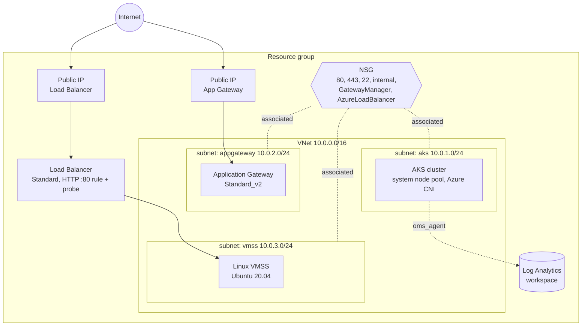

# azure-terraform-aks-infra

Modular Terraform that builds a small, lab-sized Azure environment around an **AKS cluster**: a VNet with three subnets, a shared NSG, a Standard public Load Balancer in front of a Linux **VM Scale Set**, an **Application Gateway v2**, and an AKS cluster wired into its own subnet with Azure CNI and Log Analytics monitoring.

It was written to fit an Azure for Students subscription. VM sizes and node counts are kept small, AKS uses `loadBalancer` outbound instead of user-defined routing, and the NAT Gateway / Route Table modules are kept but switched off.

## Architecture



`time_sleep` resources in `main.tf` add short waits between the networking, NSG-association and compute stages. They work around Azure API ordering races during `apply`.

## Modules

| Module | Used | Creates |
|---|---|---|
| [`vnet`](modules/vnet) | yes | `azurerm_virtual_network` |
| [`subnets`](modules/subnets) | yes | One `azurerm_subnet` per entry in `var.subnets`. The AKS subnet gets Storage/KeyVault service endpoints; the App Gateway subnet gets Web |
| [`nsg`](modules/nsg) | yes | One NSG (HTTP, HTTPS, SSH, AKS API, intra-VNet, App Gateway v2 management ports 65200-65535, LB probes), associated with all three subnets in `main.tf` |
| [`load_balancer`](modules/load_balancer) | yes | Zonal Standard public IP, Standard LB, backend pool, HTTP probe on `/`, TCP 80 rule |
| [`app_gateway`](modules/app_gateway) | yes | Standard public IP and an Application Gateway `Standard_v2` (capacity 2) with an HTTP :80 listener and an empty backend pool |
| [`vmss`](modules/vmss) | yes | `azurerm_linux_virtual_machine_scale_set` (Ubuntu 20.04 LTS Gen2, SSH-key login only, ApplicationHealthLinux extension), joined to the LB backend pool |
| [`aks`](modules/aks) | yes | Log Analytics workspace and `azurerm_kubernetes_cluster` (RBAC, system-assigned identity, autoscaling system pool, Azure CNI + Azure network policy, service CIDR `172.16.0.0/16`) |
| [`nat_gateway`](modules/nat_gateway) | commented out | NAT Gateway with a zonal public IP |
| [`route_table`](modules/route_table) | not referenced | Route table, routes and an optional AKS subnet association (for `userDefinedRouting` egress) |

## Inputs

All inputs have defaults in [`variables.tf`](variables.tf). Override them in `terraform.tfvars`, starting from [`terraform.tfvars.example`](terraform.tfvars.example).

| Name | Type | Default | Description |
|---|---|---|---|
| `resource_group_name` | string | `aks-multi-az-rg` | Resource group to create |
| `location` | string | `East US` | Azure region |
| `vnet_name` | string | `aks-vnet` | VNet name |
| `vnet_address_space` | list(string) | `["10.0.0.0/16"]` | VNet address space |
| `subnets` | map(object) | `aks`, `appgateway`, `vmss` /24s | Subnet name → `address_prefix`. The keys `aks`, `appgateway` and `vmss` are required by `main.tf` |
| `nsg_name` | string | `aks-nsg` | NSG name |
| `nat_gateway_name` | string | `aks-nat-gateway` | Only used if the NAT Gateway module is re-enabled |
| `app_gateway_name` | string | `aks-app-gateway` | Application Gateway name |
| `lb_name` | string | `aks-load-balancer` | Load Balancer name |
| `vmss_name` | string | `aks-vmss` | Scale set name |
| `vm_size` | string | `Standard_B1s` | Scale set VM size |
| `instance_count` | number | `1` | Scale set instances |
| `admin_username` | string | `azureuser` | Admin user for VMSS instances |
| `ssh_public_key_path` | string | `~/.ssh/id_rsa.pub` | Local path to the SSH **public** key put on the VMSS |
| `aks_name` | string | `aks-cluster` | AKS cluster name (also used for the DNS prefix and Log Analytics name) |
| `kubernetes_version` | string | `1.28` | AKS version. Pick a currently supported one with `az aks get-versions --location <region> -o table` |
| `node_count` | number | `1` | Minimum (and initial) system pool nodes; max is `node_count + 1` |
| `aks_vm_size` | string | `Standard_B1s` | AKS node VM size. AKS system pools need at least 2 vCPU / 4 GiB, so use something like `Standard_B2s` |
| `tags` | map(string) | `environment`, `project` | Tags applied to all resources |

## Outputs

| Name | Description |
|---|---|
| `vnet_id` | VNet ID |
| `subnet_ids` | Map of subnet name → subnet ID |
| `nsg_id` | NSG ID |
| `app_gateway_id` | Application Gateway ID |
| `lb_id` | Load Balancer ID |
| `vmss_id` | VM Scale Set ID |
| `aks_id` | AKS cluster ID |
| `aks_fqdn` | AKS API server FQDN |

## Prerequisites

- Terraform **>= 1.3** (tested with 1.10). Providers: `hashicorp/azurerm ~> 3.0`, `hashicorp/time` (versions pinned in `.terraform.lock.hcl`).
- Azure CLI, logged in to the subscription you want to deploy to:
  ```bash
  az login
  az account set --subscription "<your-subscription-id>"
  ```
  The `azurerm` provider picks up the CLI session. No credentials are stored in this repo.
- An SSH key pair. The public key path goes in `ssh_public_key_path`.
- Enough regional vCPU quota for the AKS nodes, the VMSS instances and the App Gateway.

## Usage

```bash
cp terraform.tfvars.example terraform.tfvars   # then edit it
terraform init
terraform plan -out=tfplan
terraform apply tfplan

# get cluster credentials
az aks get-credentials --resource-group <resource_group_name> --name <aks_name>
kubectl get nodes

# tear everything down
terraform destroy
```

`terraform.tfvars`, `tfplan` and state files are gitignored on purpose. Plans and state can contain subscription IDs and other sensitive values.

## Cost warning

This deploys billable resources that run until you delete them: the Application Gateway v2, the AKS nodes, the VMSS instances, two Standard public IPs, the Standard Load Balancer and Log Analytics ingestion. The Application Gateway alone costs money every hour it exists, even with no traffic.

**Run `terraform destroy` as soon as you have finished testing**, and check the portal that the resource group is gone.

## Notes and limitations

- This is a **learning/lab** setup. The NSG allows SSH (22), HTTP and HTTPS from any source. Restrict `source_address_prefix` before using anything like this for real.
- The App Gateway backend pool is empty. Point it at the VMSS, or at an AKS ingress (AGIC), to route traffic.
- State is local (there is no `backend` block). For shared use, add an `azurerm` remote backend in a storage account.
